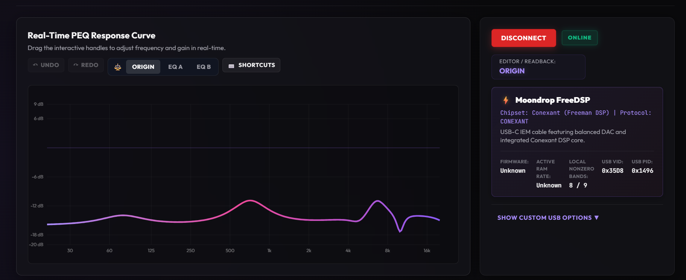
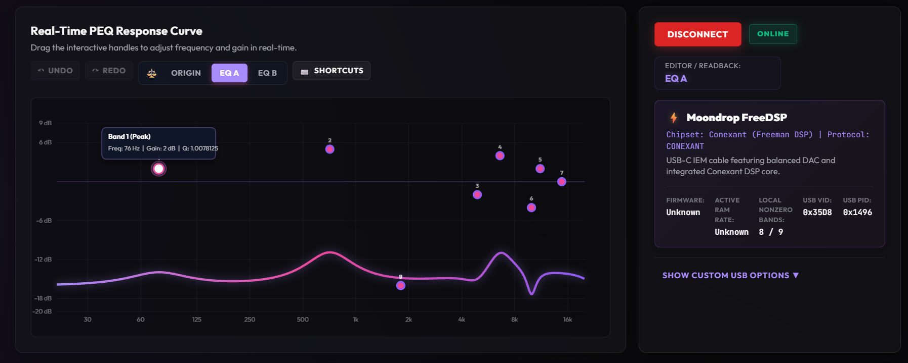
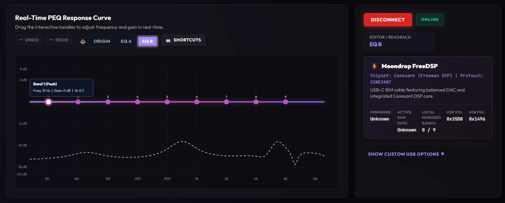

# AuraPEQ FreeDSP Edition

AuraPEQ FreeDSP Edition is an independent, FreeDSP-focused fork of Audiocular-Aura by mandy321.

[Original project](https://github.com/mandy321/Audiocular-Aura) · [This edition](https://github.com/henryshuen/Audiocular-Aura) · **[Download the Windows portable edition](https://github.com/henryshuen/Audiocular-Aura/releases)**

An unofficial Windows 11 x64 portable application for the **original Moondrop FreeDSP**. Edit nine stereo EQ bands in your browser, apply them to RAM, or save them to the device. The upstream author does not maintain or endorse this edition.

## See it in use

Real screenshots supplied by the tester from the packaged application connected to his FreeDSP:



**ORIGIN:** the captured device response, kept as a read-only reference.



**EQ A:** an editable reconstruction of the available device profile, with ORIGIN for comparison.



**EQ B:** a Flat workspace with the dashed ORIGIN reference.

## Download and quick start

1. Open this edition's [Releases page](https://github.com/henryshuen/Audiocular-Aura/releases) and download the **Windows x64 ZIP** for `v0.1.0` once published. The existing `v0.1.0-freedsp-preview` remains available unchanged. The accompanying `.sha256` file identifies its checksum.
2. Extract **all** files to a normal folder. Do not run the application from inside the ZIP.
3. Double-click **Start AuraPEQ FreeDSP Edition.exe** and keep its window running.
4. Your default browser opens **http://localhost:5173/** after the local services are ready. Use Chrome or Edge with WebHID support; if needed, open that URL in a supported browser yourself.
5. Plug in the original FreeDSP, click **CONNECT DAC**, and grant the browser device permission.
6. Select **EQ A** or **EQ B** to edit. Use **SYNC TO RAM (APPLY)** to test the result; use **SAVE TO FLASH (PERMANENT)** only when you intend to replace the saved EQ.
7. Wait for any device operation to finish. Press Enter in the launcher, or close its window, to stop the application. Closing only the browser does not stop the services.

No separate Node.js, .NET runtime or SDK, Python, Git, administrator privileges, or PowerShell knowledge is required to run the package. It does not install a browser. The browser's **INSTALL APP** / PWA control is not a FreeDSP installer and does not replace the launcher or bundled helper.

## Supported device and system

| Item | Supported scope |
|---|---|
| Device | Original Moondrop FreeDSP, Conexant / Freeman DSP |
| USB identity | VID `0x35D8`, PID `0x1496`, matching CAF HID collection |
| System | Windows 11 x64 |
| Browser | WebHID-capable Chrome or Edge |
| PEQ | Nine stereo bands: Peak (`PK`), Low Shelf (`LSQ`), High Shelf (`HSQ`) |
| Band gain | Application policy **−16 to +6 dB**, matching the official app |

Other FreeDSP revisions, other operating systems, and generic DACs are not validated targets of this release. Existing other-DAC source behavior is retained. The gain policy is not a guarantee of DSP headroom, freedom from clipping, or safe listening volume.

## ORIGIN, EQ A and EQ B

CONNECT reads an available device snapshot without applying EQ. **ORIGIN** displays its captured coefficient response and cannot be edited. **EQ A** starts from its approximate parameter reconstruction; **EQ B** starts Flat. A and B show ORIGIN as a dashed reference. Switching workspaces or editing does not write to hardware; they are local workspaces, not hardware storage slots.

A new successful CONNECT refreshes the snapshot and initializes A/B. Replaced unsaved drafts are preserved in Custom Profiles with names such as `FreeDSP recovered EQ A ...`. Failed or incomplete readback does not silently create a Flat ORIGIN or pretend to recover a profile. Browser settings and presets depend on the same localhost origin and browser profile; export important presets.

Readback has limits: Gain is whole dB, Q is raw/256, and enabled states are assumed ON locally. The captured curve is path0 at the metadata sample rate. Its precise RAM/Flash source, freshness, current active rate and other stereo path are unconfirmed. EQ A may differ from raw ORIGIN. This is neither a bit-exact backup nor a guarantee of exact restoration.

## RAM Apply and Flash Save

**SYNC TO RAM (APPLY)** sends the selected editable nine-band EQ to both stereo paths. It is a temporary change; use Flash Save if persistence is wanted. **SAVE TO FLASH (PERMANENT)** replaces the saved EQ. the tester has verified matching Flash acknowledgments and persistent EQ after physical USB reconnection.

Flash saving may take approximately **10–20 seconds**, based on current observations. Timing can vary. Do not disconnect FreeDSP or close the launcher during the transaction; wait for the final completion or failure message.

CONNECT, workspace selection and import do not trigger writes. Reset actions use an in-page confirmation and can reset RAM; they do not save Flash. A write failure stops immediately without automatic retry or rollback. An interrupted operation may have partially changed the device. Completion means matching protocol acknowledgments, not a new readback proof.

Listen at low volume and take IEMs out before the first Apply. Updates may produce click/pop transients. Positive or overlapping boosts can clip; independently verified preamp attenuation is unavailable. Do not unplug the device or close the launcher during a write.

## Import a preset

Select editable **EQ A** or **EQ B**, then use **IMPORT PRESET** with a text file in this format:

```text
Filter 1: ON PK Fc 76 Hz Gain 2 dB Q 1.01
Filter 2: ON PK Fc 712 Hz Gain 5 dB Q 1.18
Filter 3: ON PK Fc 4901 Hz Gain -2 dB Q 2.37
Filter 4: ON PK Fc 6591 Hz Gain 4 dB Q 2.20
Filter 5: ON PK Fc 11147 Hz Gain 2 dB Q 0.44
Filter 6: ON PK Fc 9952 Hz Gain -4 dB Q 6.35
Filter 7: ON PK Fc 14788 Hz Gain 0 dB Q 0.73
Filter 8: ON LSQ Fc 1800 Hz Gain -16 dB Q 0.71
Filter 9: ON HSQ Fc 1800 Hz Gain -16 dB Q 0.71
```

`ON` / `OFF` controls local band enable state. Filter numbers identify bands 1–9; frequency is Hz, Gain is dB, and Q is dimensionless. `PK`, `LSQ` and `HSQ` preserve Peak, Low Shelf and High Shelf respectively; supported shelf aliases `LS`/`LSC` and `HS`/`HSC` normalize to those types. Missing bands use neutral local bands. Unknown types, malformed lines, duplicate or extra bands, invalid ranges and unstable/overflowing coefficient models are rejected without changing the editor. Comments beginning with `#` are allowed.

The example is user-provided reference data, not a bit-exact readback or hardware backup. Rounded text exports lose precision. JSON profiles are also supported with valid band fields. A `Preamp:` value is ignored for FreeDSP and reported; it does not provide headroom. Import changes only the selected local workspace, preserves ORIGIN and performs no RAM/Flash write. Review the result before explicit Apply or Save.

## Included and excluded controls

Included: nine-band PEQ, the response curve and graphical/numeric editor, stereo RAM Apply, Flash Save, local presets/import/export/undo/redo, and the accepted Reset Defaults / Reset to Flat workflow.

FreeDSP production excludes Global Preamp / Auto Preamp, Global Tone Tilt, DAC utility Filter Type, Amp/Gain modes, Channel Balance, Microphone Gain and Loopback Monitor. Independent preamp and tone behavior is unverified; Balance and microphone UAC controls were manually validated but intentionally excluded from this product. This does not mean the hardware physically lacks every such capability. Generic utility controls must not be mistaken for FreeDSP implementations.

## Why a download is required

The original FreeDSP requires a Windows HID communication method that standard browser WebHID cannot fully access. This edition therefore includes a local helper to read and save EQ reliably. The download is larger because it bundles the required .NET runtime and application components, so users do not need to install developer tools separately.

This is a local browser interface backed by a bundled Windows helper, **not** a public browser-only hardware controller. Services bind only to loopback, validate the trusted origin and session token, and restrict operations and device identity. No LAN service or cloud USB proxy is used.

## Limitations and troubleshooting

- **Unsigned executable:** Windows SmartScreen or enterprise policy may warn or block the executable. Check its source and checksum; do not disable security protections. Testing was performed on the tester's Windows PC. No second Windows PC was available, and isolated clean-machine compatibility has not been tested. This is a disclosed coverage limitation, not a blocker for this scoped release.
- **Package evidence:** the tester tested the ZIP downloaded from GitHub: extraction/startup without installing developer tools; connection/readback; ORIGIN/A/B; nine-band PK/LSQ/HSQ import; RAM 18/18 acknowledgments with audible change; Flash 56/56 acknowledgments including commit; USB power-cycle persistence; reconnection and launcher shutdown/restart. No critical malfunction was reported. This does not validate every possible preset or Windows environment.
- **Launch fails:** extract the complete ZIP again if files are missing or changed. Close your previous AuraPEQ/dev launcher if ports 5173/5174 are occupied. The launcher never kills unrelated processes; a second launch reuses its verified owned instance.
- **No browser permission:** open http://localhost:5173/ in Chrome or Edge and check the selected device. Keep the launcher running. Do not use the upstream public website for this edition.
- **Storage/runtime:** writable Temp and LocalAppData directories are needed. Presets use browser storage. Logs are under `%TEMP%\AuraPEQ\freedsp-portable-*.log`.
- **Internet:** online catalog/database features require internet. Local editing and device communication use loopback.

## Source, license and credits

Based on [Audiocular-Aura by mandy321](https://github.com/mandy321/Audiocular-Aura). Its original design, architecture and generic DAC work are credited to the upstream authors and contributors. FreeDSP integration and portable packaging are maintained in [this independent fork](https://github.com/henryshuen/Audiocular-Aura).

The application is distributed under **GPL-3.0**; see [LICENSE](LICENSE). Packages include `LICENSE.txt`, `ACKNOWLEDGMENTS.md`, corresponding buildable `SOURCE.zip`, and Microsoft runtime licenses and third-party notices in `RUNTIME-NOTICES/`. No official APK or firmware binary is included. Product names belong to their owners; this edition is not endorsed by Moondrop, Conexant or the upstream maintainer.

## v0.1.0 archive and source provenance

The stable v0.1.0 plan retains the exact hardware-tested Preview ZIP bytes; only its external download filename changes to `AuraPEQ-FreeDSP-v0.1.0-win-x64.zip`. Its checksum is unchanged. The internal folder, version strings and package manifest still say `v0.1.0-freedsp-preview`; this is intentional, not a rebuild.

The binary and bundled `SOURCE.zip` originate from commit `13c3e148d1327e61c4f2198698020c321d7c51c6`. The stable tag will select a documentation-only revision with the same executable, frontend and protocol build inputs. GitHub's tag source archive includes those newer online documents; bundled documentation remains the tested Preview version. See corresponding source included in SOURCE.zip for the explicit mapping. No update to the existing Preview release or tag is required.

## For developers

End users do not need these tools. Source builds require Node.js/npm and the .NET 10 SDK; the validated SDK is 10.0.401 and the package pins runtime 10.0.12.

```powershell
cd C:\Projects\AuraPEQ
.\scripts\setup.ps1
.\scripts\dev.ps1
```

Development also uses http://localhost:5173/ with a separate native service. To verify and package the production build:

```powershell
.\scripts\verify.ps1
.\scripts\package-freedsp-portable.ps1
.\scripts\test-freedsp-portable.ps1
```

Packaging uses locked npm dependencies, Vite production assets and self-contained Windows publishing. Outputs default to `../AuraPEQ-FreeDSP-releases`, outside the checkout. The procedure is reproducible; ZIP timestamps need not be byte-identical across builds. Rebuild to receive future runtime updates.
